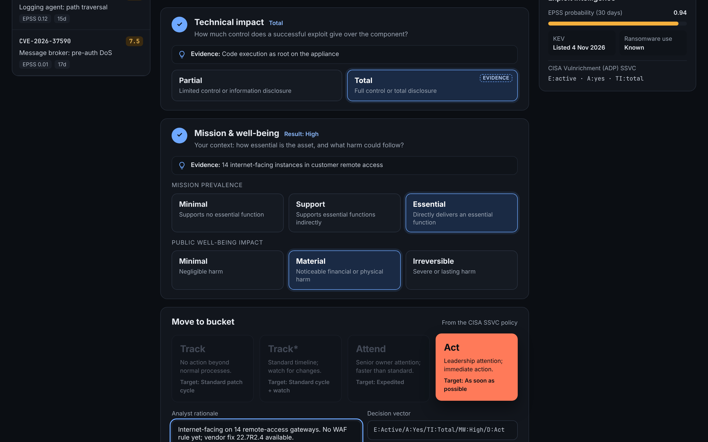
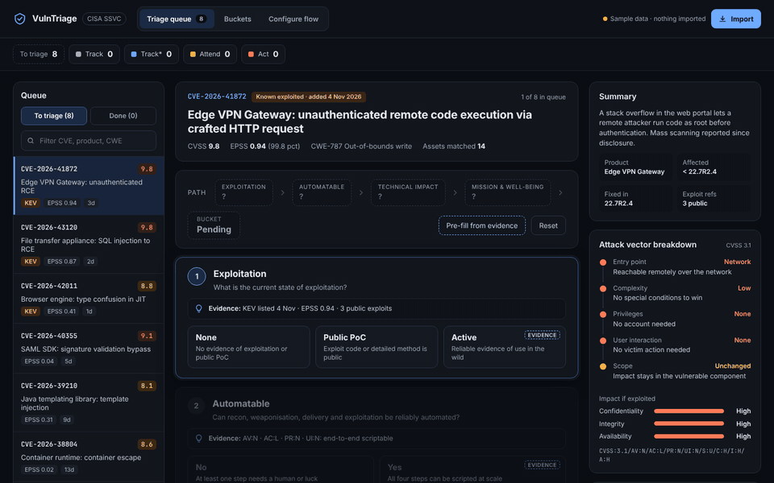
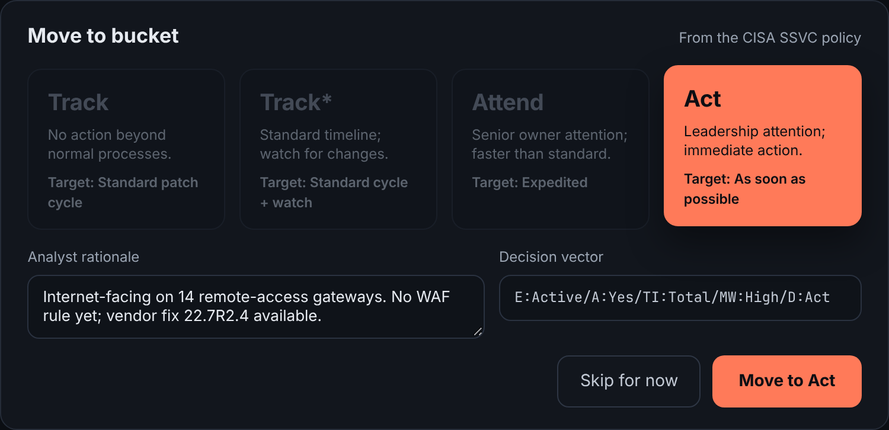
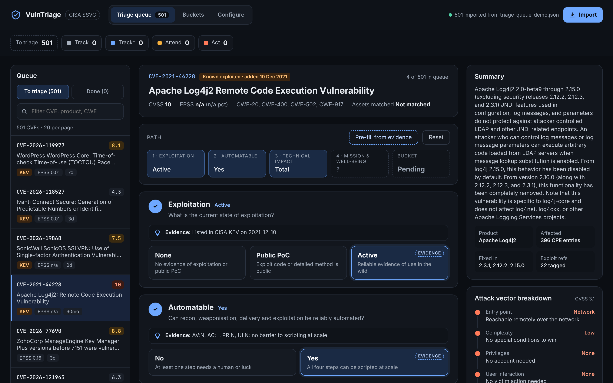
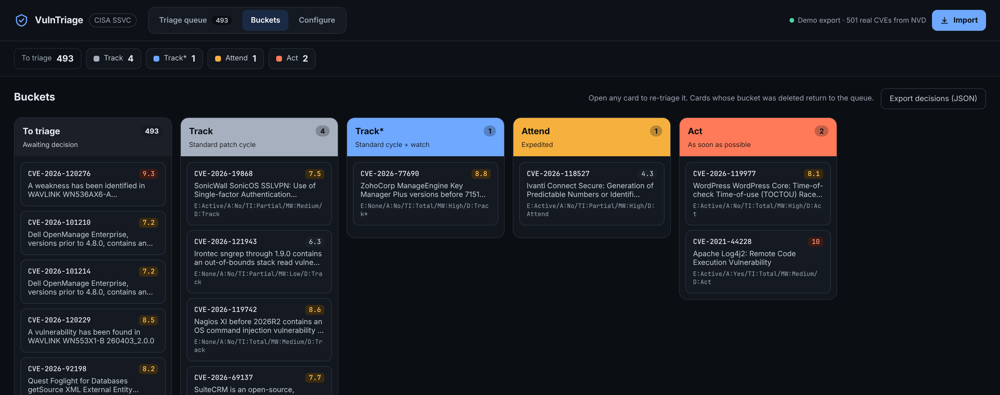
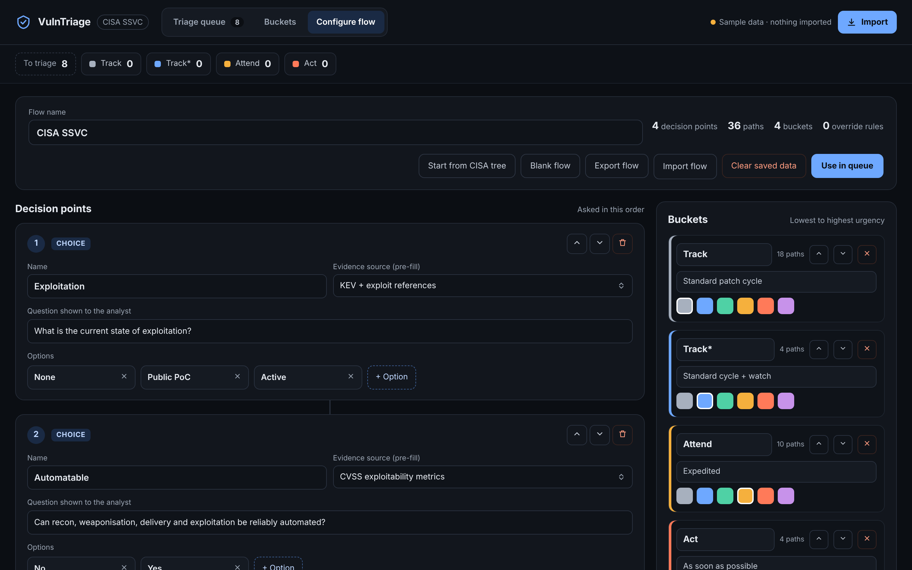
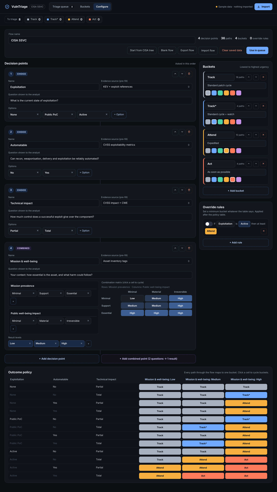
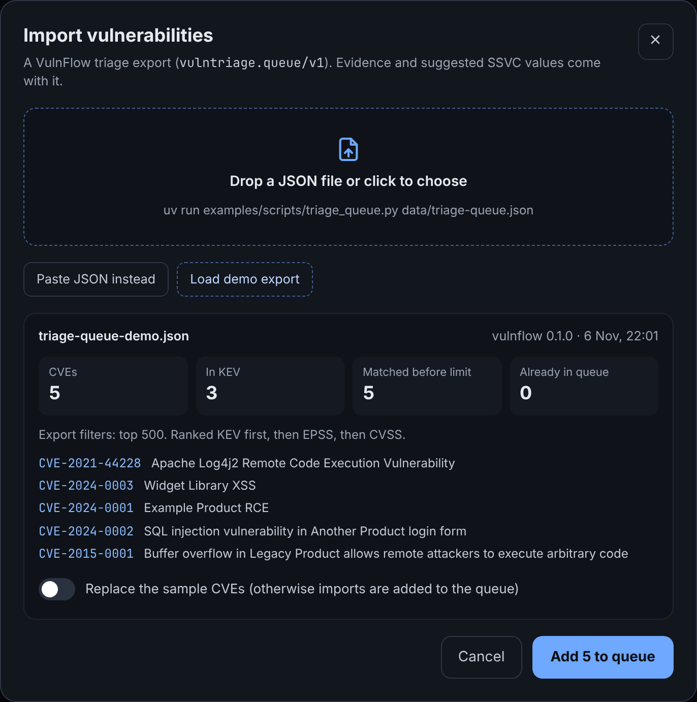
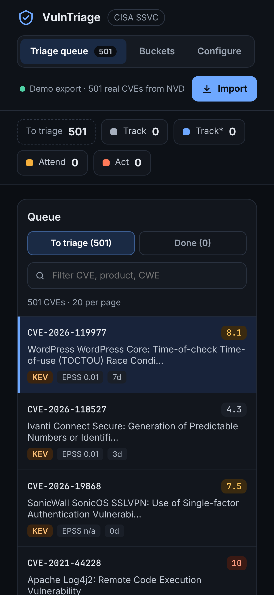

<h1 align="center">VulnTriage</h1>

<p align="center">
  An SSVC triage dashboard for vulnerability specialists: read the evidence, answer the decision points, move the CVE to a bucket, next.<br>
  One HTML page. No server, no build step, no dependencies.
</p>

<p align="center">
  <a href="LICENSE"></a>
  
  
  
  
  <a href="https://github.com/corifeo/vulnflow"></a>
</p>

<p align="center">
  
</p>

---

## Contents

- [Why this exists](#why-this-exists)
- [Quick start](#quick-start)
- [Use cases](#use-cases)
- [The triage view](#the-triage-view)
- [Buckets](#buckets)
- [Configure the flow](#configure-the-flow)
- [Importing vulnerabilities from VulnFlow](#importing-vulnerabilities-from-vulnflow)
- [Storage and formats](#storage-and-formats)
- [Development](#development)
- [Security and privacy](#security-and-privacy)
- [Limitations and roadmap](#limitations-and-roadmap)
- [License](#license)

## Why this exists

A CVSS score says how bad a bug could be. It doesn't say what to do this week. [SSVC](https://www.cisa.gov/stakeholder-specific-vulnerability-categorization-ssvc) answers that with a few plain questions: is it being exploited, can it be automated, how much control does it give, and how much does the affected thing matter to you. The answers map to a bucket (Track, Track\*, Attend, Act) with a remediation target.

Spreadsheets and ticket fields make that slow and inconsistent. VulnTriage makes it a queue:

- **Evidence next to every question.** KEV listing, EPSS, exploit references and the CVSS vector are shown on the decision point they inform, with a suggested answer.
- **The analyst decides.** Suggestions are marked, never applied silently. Mission and well-being is always a human call: no public feed knows your assets.
- **Every decision is explainable.** Each bucket move records the decision vector (`E:Active/A:Yes/TI:Total/MW:High/D:Act`), the answers and the analyst's rationale.
- **Your policy, not ours.** Start from the CISA tree, then change the questions, buckets, outcome table and override rules to match how your organisation patches.

<p align="center">
  
</p>

## Quick start

```bash
git clone https://github.com/corifeo/VulnTriage.git
cd VulnTriage
python3 -m http.server 8000
```

1. Open <http://localhost:8000>. Eight invented sample CVEs are already in the queue.
2. Press **Pre-fill from evidence**, answer **Mission & well-being**, add a rationale and **Move to bucket**.
3. Choose **Import › Load demo export** to bring in a real VulnFlow export, including Log4Shell.

Opening `index.html` straight from disk also works, except **Load demo export**, which needs HTTP.

## Use cases

| Who | Situation | How VulnTriage helps |
|---|---|---|
| **Vulnerability management analyst** | Monday morning: a week of new CVEs and a handful of fresh KEV listings | Import VulnFlow's ranked queue (KEV first, then EPSS, then CVSS). Pre-fill the three evidence-backed points, add asset context, move on. The next CVE loads automatically. |
| **On-call security engineer** | A new KEV entry hits an internet-facing product you run | Open it, confirm Active / Yes / Total from the evidence, set mission to Essential and get **Act** with a recorded rationale in under a minute, ready to paste into the incident ticket. |
| **Security lead** | Your SLAs aren't CISA's: you have four patch windows and a hard rule for anything in KEV | Rename buckets and their targets, edit the outcome table cell by cell, and add an override such as *"if Exploitation is Active, at least Attend"*. Export the flow as JSON and share it with the team. |
| **Analyst re-triaging** | A CVE you parked in Track\* now has a public exploit | Open its card on the bucket board, change Exploitation, and it moves. The new vector and rationale replace the old ones. |
| **GRC and audit** | "Why wasn't this patched in 14 days?" | **Export decisions** gives one record per CVE with bucket, decision vector, answers, rationale and timestamp. |
| **Team lead training new analysts** | Juniors score everything by CVSS | Each decision point asks a plain question, explains its options and shows the evidence behind the suggestion, so the reasoning is visible and repeatable. |

## The triage view

Three columns: the queue, the decision, and the evidence.

- **Queue.** Untriaged CVEs with KEV, EPSS and age at a glance, plus a filter by CVE, product or CWE. **Done** lists what you've decided this session.
- **Path.** The answers so far and the bucket they resolve to, updated as you click. **Pre-fill from evidence** selects every suggested option; **Reset** clears them.
- **Decision points.** One card per question, in order. Each shows the evidence line that informs it and marks the suggested option with an **Evidence** badge.
- **Right rail.** A plain-language summary, the affected and fixed versions, the CVSS vector broken down into an attack path (entry point, complexity, privileges, user interaction, scope) with C/I/A impact, and exploit intelligence: EPSS, KEV date, ransomware use and CISA Vulnrichment SSVC values where they exist.

<p align="center">
  <br>
  <sub>The outcome, its remediation target, the rationale and the decision vector that gets recorded</sub>
</p>

Imported CVEs carry real data. Here is Log4Shell from the VulnFlow demo export, pre-filled from its KEV listing and CVSS vector:



## Buckets

One column per bucket plus **To triage**, each card showing its decision vector. Open any card to re-triage it. **Export decisions (JSON)** writes every decision for reporting or audit.



## Configure the flow

The flow starts as the CISA SSVC deployer tree and everything in it can change:

- **Decision points.** Rename, reorder or delete them, edit the question shown to the analyst, add or remove options, and choose which evidence source pre-fills each one.
- **Combined points.** Two questions that resolve to one level through a matrix, like CISA's Mission & well-being (mission prevalence × public well-being impact). Click a cell to cycle its level.
- **Buckets.** Lowest to highest urgency, each with a name, a remediation target and a colour.
- **Outcome policy.** Every path through the flow maps to one bucket. Click a cell to cycle it.
- **Override rules.** Minimum buckets that apply after the policy table, such as *"if Exploitation is Active, at least Attend"*.

**Export flow** and **Import flow** move it between browsers and people; **Blank flow** starts from nothing.

<table>
  <tr>
    <td width="50%" valign="top"></td>
    <td width="50%" valign="top"></td>
  </tr>
  <tr>
    <td align="center"><sub>Decision points, buckets and override rules</sub></td>
    <td align="center"><sub>The full flow, down to the 36-path outcome policy</sub></td>
  </tr>
</table>

## Importing vulnerabilities from VulnFlow

VulnTriage reads `vulntriage.queue/v1` JSON. [VulnFlow](https://github.com/corifeo/vulnflow)'s `TriageLoader` writes it from NVD with KEV, EPSS and CVSS already joined, ranked KEV first, then EPSS, then CVSS:

```python
from vulnflow.helpers import CacheBuilder
from vulnflow.loaders import TriageLoader

ds = CacheBuilder(recent_only=True).build()
TriageLoader("triage-queue.json", min_epss=0.01).load(ds)
```

Or, from a VulnFlow checkout:

```bash
uv run examples/scripts/triage_queue.py data/triage-queue.json --min-epss 0.01
```

> [!NOTE]
> `TriageLoader` is on VulnFlow's `feat/triage-bench-loader` branch and not yet released.

Then **Import** in the top bar and drop the file in. The preview shows how many CVEs, how many are in KEV and how many are already in the queue. Re-imported CVEs are updated, not duplicated; switch on **Replace the sample CVEs** to drop the built-in examples.

<p align="center">
  
</p>

Suggested values cover Exploitation, Automatable and Technical impact:

| Decision point | Suggested when |
|---|---|
| Exploitation | `active` if in KEV or CVSS v4 E:A; `poc` if a reference is tagged Exploit or E:P; otherwise `none` |
| Automatable | `yes` only with AV:N, AC:L, PR:N and UI:N (CVSS v4 AU wins when present) |
| Technical impact | `total` with high confidentiality and integrity impact; otherwise `partial` |

Anything else can produce the format too. It's documented in [`docs/queue-schema.md`](docs/queue-schema.md), and a demo export with the real Log4Shell record is in [`examples/triage-queue-demo.json`](examples/triage-queue-demo.json).

## Storage and formats

Everything lives in the browser's `localStorage`. Nothing is sent anywhere.

> [!IMPORTANT]
> Clearing site data removes your decisions. Export them from **Buckets** and your flow from **Configure flow** before you do. **Clear saved data** in Configure flow resets the page to the sample data.

| Format | Written by | Contents |
|---|---|---|
| `vulntriage.queue/v1` | VulnFlow `TriageLoader`, or your own tooling | CVEs to triage, with evidence and suggested values |
| `vulntriage.decisions/v1` | Buckets › Export decisions | One entry per decided CVE: bucket, vector, answers, rationale, time |
| `vulntriage.flow/v1` | Configure › Export flow | Decision points, buckets, outcome policy and override rules |

<table>
  <tr>
    <td width="30%" valign="top"></td>
    <td valign="top">
      <b>Works at phone width.</b> The three columns stack, so you can check a queue or a decision from a phone. The page is dark-themed throughout.
    </td>
  </tr>
</table>

## Development

```
index.html               the page and its template
src/runtime.js           ~200-line template renderer ({{holes}}, <sc-for>, <sc-if>, events)
src/app.js               state, SSVC engine, import, flow builder
scripts/screenshots.cjs  regenerates docs/screenshots with Playwright
docs/                    file formats and screenshots
examples/                VulnFlow demo export
```

There is nothing to build: edit the files and reload. To regenerate the screenshots and the GIF (ffmpeg is needed for the GIF):

```bash
npm install --no-save playwright && npx playwright install chromium
node scripts/screenshots.cjs
```

The script serves the repository itself, clears local storage, and drives the real page through the sample data and the demo export.

## Security and privacy

- Keep real decision exports and queues out of public repositories: rationales often name internal systems.
- Data is stored unencrypted in the browser's local storage. Anyone with access to that browser profile can read it.
- Imported text is escaped before rendering.
- The only external request is for Google Fonts. Remove the link in `index.html` to stop it.

## Limitations and roadmap

**Current limitations**

- **The CISA outcome table is transcribed by hand.** It needs tests against the CISA SSVC guide before anyone relies on it.
- **Single browser.** Sharing a queue across a team needs a backend; for now, move flows and decisions as JSON.
- **The eight built-in sample CVEs are invented.** They disappear once you import with **Replace the sample CVEs**.
- **Asset context is manual.** Mission prevalence and well-being are answered by the analyst every time.

**Planned**

- [ ] Tests for the SSVC engine against the CISA decision table
- [ ] Asset inventory import, to suggest mission prevalence and well-being
- [ ] Remediation due dates from bucket targets, and overdue flags
- [ ] Decisions export to CSV and ticketing systems
- [ ] Shared queue with an audit trail
- [ ] Light theme

## License

Released under the [MIT License](LICENSE).
